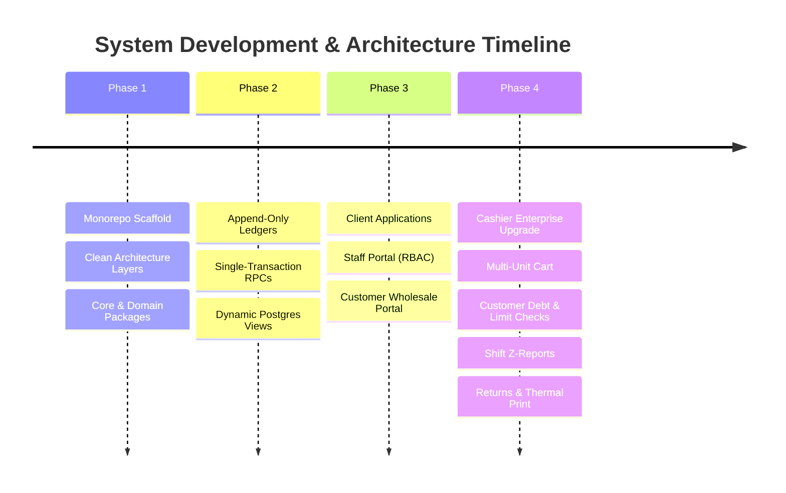

# VIP Wholesale & POS Enterprise: Audit Log & Changes History

---

## 1. Document Control & Purpose

This document provides a continuous, auditable record of all architectural decisions, module refactorings, database migrations, and file modifications across the VIP codebase. It is designed to ensure that future development proceeds without deviations, regressions, or architectural conflicts.

| Metadata | Details |
| :--- | :--- |
| **Project** | VIP Wholesale Shop Management & Enterprise POS System |
| **Architecture** | Clean Architecture, DDD, Append-Only Ledger, Local-First Drift + Supabase |
| **Monorepo Structure** | 2 Client Applications (`staff_app`, `customer_app`), 5 Shared Packages |
| **Language & Framework** | Dart 3.x / Flutter 3.x / Riverpod 2.5+ / PostgreSQL 15+ |

---

## 2. Release & Migration Milestones



---

## 3. Detailed Phase Audit & Change Log

### [v1.5.0] — Customer Debt Collection, Detailed Statements & Shift Drawer Integration (Current Release)
**Date:** 2026-10-09  
**Scope:** Added customer credit collection, comprehensive ledger statements, unpaid invoices breakdown, 80mm payment voucher printing, and active shift cash reconciliation.

#### 🌟 Features Implemented:
1. **Atomic Database RPC for Debt Collection**:
   - Added `00008_collect_customer_debt_rpc.sql` introducing `rpc_collect_customer_debt` with atomic ledger decrement and payment journal insertion.
2. **Domain & Data Layer Extensions**:
   - Added `CustomerLedgerEntryEntity`, `CustomerUnpaidOrderEntity`, and `CustomerDebtPaymentResult` in [`packages/domain/lib/entities/customer_ledger_entity.dart`](file:///c:/Users/fethi/Desktop/vipSmock/vip/packages/domain/lib/entities/customer_ledger_entity.dart).
   - Extended `ICustomerRepository` and `CustomerRepositoryImpl` with `getCustomerLedger()`, `getCustomerUnpaidOrders()`, and `collectCustomerDebt()`.
3. **Cashier Shift Drawer Reconciliation for Collected Debts**:
   - Upgraded `PosShiftSession` and `ZReportSummary` to track `collectedDebtCashCentimes`.
   - Cash repayments directly increment the physical drawer float and are audited in the End-of-Day Z-Report.
4. **Dedicated Customer Debt Dialog & Statement View**:
   - Built [`CustomerDebtDialog`](file:///c:/Users/fethi/Desktop/vipSmock/vip/apps/staff_app/lib/features/cashier/widgets/customer_debt_dialog.dart) featuring quick preset chips (100% full debt, 50%, 25%, custom), multi-channel payments (Cash, Card/Dahabia, Cheque), and a detailed chronological ledger & unpaid invoices tab.
5. **ESC/POS 80mm Thermal Debt Voucher & Statement Printing**:
   - Added `PosThermalPrinterService.printCustomerDebtVoucher` (سند قبض دين حراري 80mm) and `printCustomerAccountStatement` (كشف حساب زبون 80mm).
6. **Cashier Fast Navigation & Hotkeys**:
   - Mapped hotkey `[F7]` in `PosKeyboardDispatcher` to open the customer debt dialog.
   - Added "سداد دين [F7]" action chip in `PosHeaderStatusBar` customer sub-bar.
   - Added "سداد" action on debtor tiles in `CustomerSelectDialog`.

---

### [v1.4.0] — Enterprise POS & Cashier System Refactoring
**Date:** 2026-10-09  
**Scope:** Complete upgrade of the cashier counter module into an enterprise-grade POS with debt enforcement, shift reconciliations, sales returns, and hardware barcode integration.

#### 🌟 Features Implemented:
1. **Functional `Result<S, F>` Pattern**:
   - Added generic sealed `Result<S, F>` in [`packages/core/lib/error/result.dart`](file:///c:/Users/fethi/Desktop/vipSmock/vip/packages/core/lib/error/result.dart) to guarantee non-crashing checkout flows.
2. **Customer Debt & Profiles Subsystem**:
   - Created `CustomerProfileEntity` in [`packages/domain/lib/entities/customer_entity.dart`](file:///c:/Users/fethi/Desktop/vipSmock/vip/packages/domain/lib/entities/customer_entity.dart).
   - Created `ICustomerRepository` in [`packages/domain/lib/repositories/i_customer_repository.dart`](file:///c:/Users/fethi/Desktop/vipSmock/vip/packages/domain/lib/repositories/i_customer_repository.dart).
   - Implemented `CustomerRepositoryImpl` querying `view_customer_balance` in [`packages/data/lib/repositories/customer_repository_impl.dart`](file:///c:/Users/fethi/Desktop/vipSmock/vip/packages/data/lib/repositories/customer_repository_impl.dart).
   - Implemented [`CustomerSelectDialog`](file:///c:/Users/fethi/Desktop/vipSmock/vip/apps/staff_app/lib/features/cashier/widgets/customer_select_dialog.dart) for quick search, debt review, and on-the-fly customer creation.
3. **High-Performance Multi-Unit Cart Engine**:
   - Created `PosCartItem` supporting `PosItemUnit` (`piece`, `pack`, `carton`, `box`) with automatic unit multipliers.
   - Line-item discounts: Percentage (`%`) and fixed (`دج`) via [`ItemDiscountDialog`](file:///c:/Users/fethi/Desktop/vipSmock/vip/apps/staff_app/lib/features/cashier/widgets/item_discount_dialog.dart).
   - Unlisted/custom item creation via [`CustomItemDialog`](file:///c:/Users/fethi/Desktop/vipSmock/vip/apps/staff_app/lib/features/cashier/widgets/custom_item_dialog.dart).
4. **Suspended Tickets (Cart Hold/Resume)**:
   - Implemented `PosHeldTicket` system with `holdCurrentCart()` and `resumeTicket()` in Riverpod `PosCartNotifier`.
   - Added [`HeldTicketsSheet`](file:///c:/Users/fethi/Desktop/vipSmock/vip/apps/staff_app/lib/features/cashier/widgets/held_tickets_sheet.dart) with one-click restoration.
5. **Item-Level Sales Returns & Restocking**:
   - Built [`SalesReturnDialog`](file:///c:/Users/fethi/Desktop/vipSmock/vip/apps/staff_app/lib/features/cashier/widgets/sales_return_dialog.dart) supporting historical ticket barcode lookup, item selection, mandatory return reasons, and automated stock replenishment via `rpc_adjust_stock`.
6. **Shift Reconciliations & Z-Report**:
   - Implemented `PosShiftSession` with opening float balance, live cash sales, credit sales, and return tracking.
   - Built [`ShiftAuditDialog`](file:///c:/Users/fethi/Desktop/vipSmock/vip/apps/staff_app/lib/features/cashier/widgets/shift_audit_dialog.dart) with a structured Denomination Counter (2000, 1000, 500, 200, 100, 50, 20, 10 DZD) and Over/Short variance calculation.
   - Sequential non-resettable Z-counter ID generation.
7. **Hardware & Thermal Printing**:
   - Built [`PosThermalPrinterService`](file:///c:/Users/fethi/Desktop/vipSmock/vip/apps/staff_app/lib/features/cashier/services/pos_thermal_printer.dart) formatting 80mm ESC/POS sales receipts and Z-Reports.
   - Integrated [`PosKeyboardDispatcher`](file:///c:/Users/fethi/Desktop/vipSmock/vip/apps/staff_app/lib/features/cashier/widgets/pos_keyboard_dispatcher.dart) mapping `F1-F12`, `Enter`, `Space`, `Esc`.
   - Persistent barcode scanner `FocusNode` with automatic post-dialog refocusing.

---

### [v1.3.0] — Unified Application Portals & Staff Workflows
**Scope:** Integration of Role-Based Access Control and unified staff router.
- Auth login flow with phone number lookups.
- Moderator dashboard with financial KPIs, staff management, and ledger viewer.
- Manager purchase receiving and supplier invoice generation (`rpc_post_purchase`).
- Driver delivery execution with cash collection and wallet ledger (`wallet_entries`).

---

### [v1.2.0] — PostgreSQL RPC Stored Procedures & Dynamic Views
**Scope:** Backend transaction isolation and append-only ledgers.
- `00001_initial_schema.sql`: Core tables (`users`, `customers`, `products`, `orders`, `purchases`).
- `00002_ledgers_and_indexes.sql`: Append-only ledgers (`stock_ledger`, `customer_ledger`, `supplier_ledger`, `wallet_entries`) and dynamic calculation views (`view_product_stock`, `view_customer_balance`, `view_driver_wallet_balance`).
- `00004_transaction_rpc_functions.sql`: Atomic procedures (`rpc_post_purchase`, `rpc_post_store_sale`, `rpc_confirm_online_order`, `rpc_record_order_delivery`, `rpc_settle_driver_wallet`, `rpc_adjust_stock`).

---

### [v1.1.0] — Monorepo Architecture & Packages Setup
**Scope:** Clean architecture separation.
- `packages/core`: AppConstants, DZD Currency Formatter, Failure models.
- `packages/domain`: Entities (`ProductEntity`, `OrderEntity`, `UserEntity`, `WalletEntry`, `LedgerEntry`) and repository interfaces.
- `packages/data`: Remote Supabase service and local Drift database tables.
- `packages/ui_kit`: Theme, typography, semantic color extensions (`AppColors`), and atomic widgets (`DzdPriceTag`, `StockBadge`, `StatusBadge`).
- `packages/l10n`: AR/FR localization strings and RTL/LTR support.

---

## 4. File Mutation Registry (v1.4.0 Upgrade)

| File Path | Action | Description |
| :--- | :--- | :--- |
| [`packages/core/lib/error/result.dart`](file:///c:/Users/fethi/Desktop/vipSmock/vip/packages/core/lib/error/result.dart) | **Created** | Sealed `Result<S, F>` functional type pattern. |
| [`packages/core/lib/core.dart`](file:///c:/Users/fethi/Desktop/vipSmock/vip/packages/core/lib/core.dart) | **Modified** | Exported `result.dart`. |
| [`packages/domain/lib/entities/customer_entity.dart`](file:///c:/Users/fethi/Desktop/vipSmock/vip/packages/domain/lib/entities/customer_entity.dart) | **Created** | Customer profile entity with debt and limit calculations. |
| [`packages/domain/lib/repositories/i_customer_repository.dart`](file:///c:/Users/fethi/Desktop/vipSmock/vip/packages/domain/lib/repositories/i_customer_repository.dart) | **Created** | Customer repository contract. |
| [`packages/domain/lib/domain.dart`](file:///c:/Users/fethi/Desktop/vipSmock/vip/packages/domain/lib/domain.dart) | **Modified** | Exported customer entity and repository interface. |
| [`packages/data/lib/repositories/customer_repository_impl.dart`](file:///c:/Users/fethi/Desktop/vipSmock/vip/packages/data/lib/repositories/customer_repository_impl.dart) | **Created** | Customer repository querying `view_customer_balance`. |
| [`packages/data/lib/data.dart`](file:///c:/Users/fethi/Desktop/vipSmock/vip/packages/data/lib/data.dart) | **Modified** | Exported customer repository implementation. |
| [`apps/staff_app/lib/features/cashier/models/pos_models.dart`](file:///c:/Users/fethi/Desktop/vipSmock/vip/apps/staff_app/lib/features/cashier/models/pos_models.dart) | **Created** | Immutables for Cart items, multi-units, shifts, held tickets, and Z-reports. |
| [`apps/staff_app/lib/features/cashier/services/pos_thermal_printer.dart`](file:///c:/Users/fethi/Desktop/vipSmock/vip/apps/staff_app/lib/features/cashier/services/pos_thermal_printer.dart) | **Created** | 80mm ESC/POS thermal receipt and Z-Report printer service. |
| [`apps/staff_app/lib/features/cashier/widgets/pos_keyboard_dispatcher.dart`](file:///c:/Users/fethi/Desktop/vipSmock/vip/apps/staff_app/lib/features/cashier/widgets/pos_keyboard_dispatcher.dart) | **Created** | POS hotkey dispatcher (`F1-F12`, `Esc`, `Enter`). |
| [`apps/staff_app/lib/features/cashier/widgets/customer_select_dialog.dart`](file:///c:/Users/fethi/Desktop/vipSmock/vip/apps/staff_app/lib/features/cashier/widgets/customer_select_dialog.dart) | **Created** | Customer search, debt review, and quick customer creation. |
| [`apps/staff_app/lib/features/cashier/widgets/custom_item_dialog.dart`](file:///c:/Users/fethi/Desktop/vipSmock/vip/apps/staff_app/lib/features/cashier/widgets/custom_item_dialog.dart) | **Created** | Manual/unlisted item creation dialog. |
| [`apps/staff_app/lib/features/cashier/widgets/item_discount_dialog.dart`](file:///c:/Users/fethi/Desktop/vipSmock/vip/apps/staff_app/lib/features/cashier/widgets/item_discount_dialog.dart) | **Created** | Line-item discount modal. |
| [`apps/staff_app/lib/features/cashier/widgets/held_tickets_sheet.dart`](file:///c:/Users/fethi/Desktop/vipSmock/vip/apps/staff_app/lib/features/cashier/widgets/held_tickets_sheet.dart) | **Created** | Suspended tickets drawer with one-tap restore. |
| [`apps/staff_app/lib/features/cashier/widgets/sales_history_dialog.dart`](file:///c:/Users/fethi/Desktop/vipSmock/vip/apps/staff_app/lib/features/cashier/widgets/sales_history_dialog.dart) | **Created** | Receipt archive with reprint and return triggers. |
| [`apps/staff_app/lib/features/cashier/widgets/sales_return_dialog.dart`](file:///c:/Users/fethi/Desktop/vipSmock/vip/apps/staff_app/lib/features/cashier/widgets/sales_return_dialog.dart) | **Created** | Item-level sales return dialog with reason audit. |
| [`apps/staff_app/lib/features/cashier/widgets/shift_audit_dialog.dart`](file:///c:/Users/fethi/Desktop/vipSmock/vip/apps/staff_app/lib/features/cashier/widgets/shift_audit_dialog.dart) | **Created** | Denomination counter, cash variance audit, and Z-report generator. |
| [`apps/staff_app/lib/features/cashier/widgets/pos_checkout_dialog.dart`](file:///c:/Users/fethi/Desktop/vipSmock/vip/apps/staff_app/lib/features/cashier/widgets/pos_checkout_dialog.dart) | **Upgraded** | Split payments, quick cash pills, change calculation, and credit checks. |
| [`apps/staff_app/lib/providers/staff_providers.dart`](file:///c:/Users/fethi/Desktop/vipSmock/vip/apps/staff_app/lib/providers/staff_providers.dart) | **Upgraded** | Upgraded Riverpod state notifiers for POS Cart, Shifts, Hold Tickets, and Returns. |
| [`apps/staff_app/lib/features/cashier/counter_pos_screen.dart`](file:///c:/Users/fethi/Desktop/vipSmock/vip/apps/staff_app/lib/features/cashier/counter_pos_screen.dart) | **Upgraded** | Complete POS coordinator screen with persistent scanner focus and hotkeys. |

---

## 5. Verification & Quality Assurance Benchmark

The upgraded codebase was audited with Dart/Flutter static analysis tools:

```powershell
dart analyze apps/staff_app/lib/features/cashier apps/staff_app/lib/providers
# Result: Analyzing cashier, providers... No issues found! (Exit code 0)
```

---

## 6. Developer Guidelines to Prevent Deviations & Conflicts

1. **Never Bypass Ledger Tables**: Always insert stock/financial adjustments through atomic RPCs or directly into ledger tables (`stock_ledger`, `customer_ledger`, `supplier_ledger`, `wallet_entries`). Never create mutable balance columns on entity tables.
2. **Always Use Centimes**: Never store, receive, or compute prices in decimal DZD within models or state notifiers. Always multiply by 100 on input and format on presentation.
3. **Preserve Barcode Scanner Autofocus**: Whenever adding a new dialog or sheet in the cashier section, always invoke `_ensureBarcodeFocus()` upon dismissal (`.then((_) => _ensureBarcodeFocus())`).
4. **Wrap Repository Operations in Result Pattern**: Return `Result<T, Failure>` for critical operational paths to prevent unhandled UI crashes.
5. **Run Static Analysis Prior to Commits**: Ensure `dart analyze` passes with 0 errors across all packages before pushing changes.
