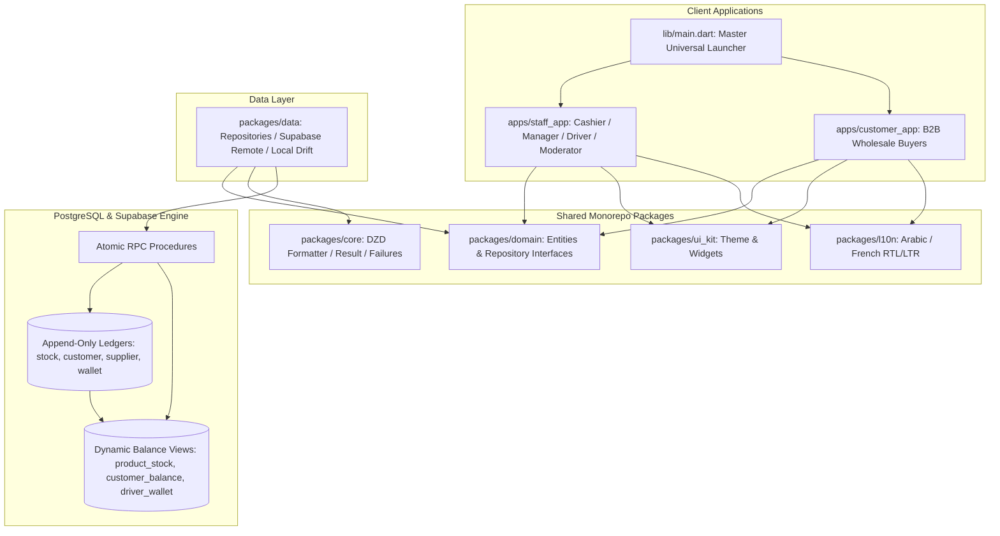

# VIP Wholesale & POS Enterprise System: Master Context Document

---

## 1. System Overview & Vision

**VIP Wholesale & POS Management System** is an offline-resilient, high-throughput enterprise platform built with Flutter and Dart, backed by an append-only PostgreSQL/Supabase engine and a local-first Drift SQLite architecture.

The platform serves two primary user interfaces within a single monorepo:
1. **`staff_app`**: Internal enterprise operations covering **Moderators** (administrators), **Managers** (inventory & purchases), **Cashiers** (high-speed counter POS, shift audits, returns, customer debt), and **Drivers** (logistics, deliveries, and cash collection).
2. **`customer_app`**: B2B Wholesale ordering portal for retail store clients, providing tiered wholesale catalog browsing, profile address setup, and real-time order lifecycle tracking.

---

## 2. Core Architectural Invariants (Non-Negotiable Principles)

Every developer and contributor MUST adhere to the following 5 architectural rules:

### 2.1 The Zero-Editable State Principle (Append-Only Ledgers)
Balances, stock levels, driver wallets, and customer debts are **never** stored as raw mutable integer/float columns.
- **Stock Balance**: Dynamically aggregated from `stock_ledger` records (minus reserved quantities in pending orders) through `view_product_stock`.
- **Customer Debt**: Aggregated from `customer_ledger` through `view_customer_balance`.
- **Driver Delivery Wallet**: Aggregated from `wallet_entries` through `view_driver_wallet_balance`.
- **Supplier Balance**: Aggregated from `supplier_ledger` through `view_supplier_balance`.

### 2.2 Financial Precision (Centimes Integer System)
All currency values throughout the entire codebase are strictly represented as **integer centimes (`BIGINT` in SQL, `int` in Dart)**:
$$\text{Amount in Centimes} = \text{Amount in DZD} \times 100$$
- Eliminates IEEE-754 floating-point inaccuracies.
- Formatted for display using [`DzdFormatter.formatCentimes(int centimes)`](file:///c:/Users/fethi/Desktop/vipSmock/vip/packages/core/lib/constants/dzd_formatter.dart) or [`DzdPriceTag`](file:///c:/Users/fethi/Desktop/vipSmock/vip/packages/ui_kit/lib/widgets/dzd_price_tag.dart).

### 2.3 Strict Clean Architecture & Monorepo Separation
- **`packages/core`**: Zero dependencies outside foundational Dart/Flutter. Contains failure classes, `Result<S, F>`, currency formatting, and constants.
- **`packages/domain`**: Pure Dart. Zero Flutter dependencies. Contains entities and repository interfaces.
- **`packages/data`**: Infrastructure layer implementing domain repositories, managing remote Supabase RPCs, and local Drift database caching.
- **`packages/ui_kit`**: Design system tokens (colors, spacing, radius, typography) and atomic widgets.
- **`packages/l10n`**: Arabic (RTL, default) and French (LTR) localizations.

### 2.4 Functional Error Handling (`Result<S, F>` Pattern)
To ensure the POS never crashes during active checkout or synchronization, all operations return a sealed `Result<S, F>`:
```dart
sealed class Result<S, F extends Failure> { ... }
class Success<S, F extends Failure> extends Result<S, F> { final S value; ... }
class FailureResult<S, F extends Failure> extends Result<S, F> { final F error; ... }
```

### 2.5 Offline Resilience & Idempotent Ingestion
Every state mutation originating on client devices generates a client-side UUID (`client_id`). Backend RPCs enforce idempotency to guarantee that network retries or offline replay queues never double-count cash or duplicate inventory deductions.

---

## 3. High-Level Architecture Diagram



---

## 4. Module Specifications & Business Workflows

### 4.1 Cashier Section & Point of Sale (POS)
Located at [`apps/staff_app/lib/features/cashier/`](file:///c:/Users/fethi/Desktop/vipSmock/vip/apps/staff_app/lib/features/cashier/):
1. **Catalog & High-Throughput Search ([F1])**:
   - `GridView.builder` / `ListView.builder` virtualization handling 10,000+ SKUs.
   - Multi-field indexing: Barcode, SKU, Arabic title, French title, Category.
2. **Cart Engine & Multi-Unit Selector**:
   - Multi-unit switching: Piece (`قطعة`), Pack (`حزمة`), Carton (`كرتون`), Box (`صندوق`).
   - Line-item discounts: Percentage (`%`) and fixed (`دج`).
   - Custom unlisted item generation (**[F3]**).
3. **Customer Debt & Profiles ([F2])**:
   - Quick search by Name / Phone / ID.
   - Live banner showing previous debt, credit limit, and remaining credit.
   - Deferred checkout ("Sell on Credit" / On Account) with strict credit limit checks.
4. **Suspended Tickets / Hold Carts ([F4] / [F5])**:
   - Instant cart suspension (`PosHeldTicket`) to handle another customer.
   - One-tap ticket recovery and discard.
5. **Sales Returns & Audit Log ([F9])**:
   - Receipt lookup via barcode scan or Order ID.
   - Item-level return quantity selection with refund calculation.
   - Mandatory return reasons (*Wrong Item*, *Damaged*, *Expired*, *Customer Preference*).
   - Optional automatic stock replenishment.
6. **Shift Audit & Z-Report ([F10])**:
   - Opening float balance registration (*Fond de caisse*).
   - Structured Denomination Counter (2000, 1000, 500, 200, 100, 50, 20, 10 DZD).
   - Live variance calculator (Counted Cash vs Expected Cash: Over/Short).
   - Sequential non-resettable Z-counter ID increment.
7. **Hardware & Hotkeys**:
   - Dedicated auto-refocusing barcode scanner `FocusNode`.
   - Complete keyboard shortcut dispatcher: `F1-F12`, `Space`, `Enter`, `Esc`.
   - 80mm ESC/POS thermal receipt and Z-Report printing via `pdf` and `printing`.

### 4.2 Manager Module (Purchases & Inventory)
Located at [`apps/staff_app/lib/features/manager/`](file:///c:/Users/fethi/Desktop/vipSmock/vip/apps/staff_app/lib/features/manager/):
- Supplier invoice receiving with multiple line items, unit costs, and suggested selling prices.
- Atomic `rpc_post_purchase` execution (updates `stock_ledger`, updates product `last_unit_cost`, updates `supplier_ledger`).
- Multi-tier pricing configuration (Retail, Wholesale, Bulk).

### 4.3 Driver Logistics & Delivery Module
Located at [`apps/staff_app/lib/features/driver/`](file:///c:/Users/fethi/Desktop/vipSmock/vip/apps/staff_app/lib/features/driver/):
- Route and order delivery assignment view.
- Delivery recording with cash collection and client-side idempotency UUID (`client_id`).
- Driver delivery wallet tracking (`wallet_entries`).
- End-of-day cash handover settlement with Cashier (`rpc_settle_driver_wallet`).

### 4.4 Moderator Dashboard & Financial Audits
Located at [`apps/staff_app/lib/features/moderator/`](file:///c:/Users/fethi/Desktop/vipSmock/vip/apps/staff_app/lib/features/moderator/):
- Live revenue, margin, and stock valuation KPIs.
- Ledger audit logs (`stock_ledger`, `customer_ledger`, `supplier_ledger`, `settlements`).
- Dynamic staff user creation and role assignments (`moderator`, `manager`, `cashier`, `driver`).

---

## 5. Directory Structure & Key Files

```
vip/
├── apps/
│   ├── staff_app/
│   │   ├── lib/
│   │   │   ├── features/
│   │   │   │   ├── auth/login_screen.dart
│   │   │   │   ├── cashier/
│   │   │   │   │   ├── models/pos_models.dart
│   │   │   │   │   ├── services/pos_thermal_printer.dart
│   │   │   │   │   ├── widgets/
│   │   │   │   │   │   ├── custom_item_dialog.dart
│   │   │   │   │   │   ├── customer_select_dialog.dart
│   │   │   │   │   │   ├── held_tickets_sheet.dart
│   │   │   │   │   │   ├── item_discount_dialog.dart
│   │   │   │   │   │   ├── pos_checkout_dialog.dart
│   │   │   │   │   │   ├── pos_keyboard_dispatcher.dart
│   │   │   │   │   │   ├── sales_history_dialog.dart
│   │   │   │   │   │   ├── sales_return_dialog.dart
│   │   │   │   │   │   └── shift_audit_dialog.dart
│   │   │   │   │   └── counter_pos_screen.dart
│   │   │   │   ├── driver/driver_deliveries_screen.dart
│   │   │   │   ├── manager/purchase_receiving_screen.dart
│   │   │   │   └── moderator/moderator_dashboard_screen.dart
│   │   │   ├── providers/staff_providers.dart
│   │   │   ├── router/staff_router.dart
│   │   │   └── main.dart
│   │   └── pubspec.yaml
│   └── customer_app/
│       ├── lib/
│       │   ├── features/catalog/catalog_screen.dart
│       │   ├── features/orders/my_orders_screen.dart
│       │   ├── providers/customer_providers.dart
│       │   └── main.dart
│       └── pubspec.yaml
├── packages/
│   ├── core/ (Result, Failures, DZD Formatter, AppConstants)
│   ├── domain/ (Entities & Repository Interfaces)
│   ├── data/ (Repositories, Remote Supabase, Local Drift SQLite)
│   ├── ui_kit/ (Design tokens, Colors, Spacing, Radius, Widgets)
│   └── l10n/ (Arabic & French ARB files)
└── backend/supabase/ (Postgres SQL Migrations 00001-00007, seed.sql, clean_start.sql)
```
