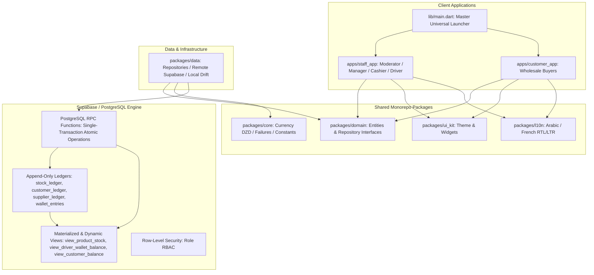
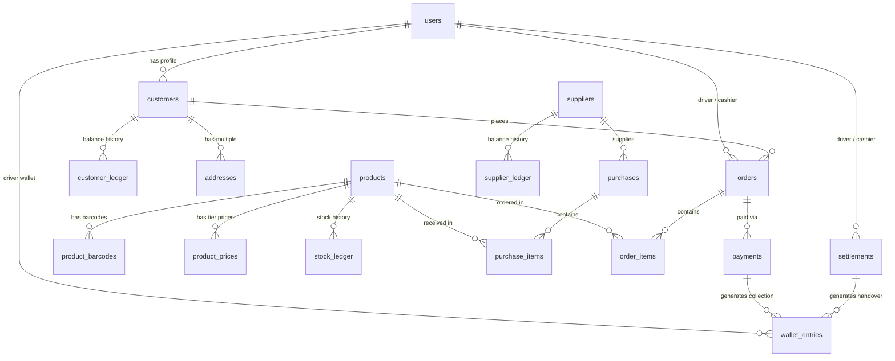

# Wholesale Shop Management System: Comprehensive Developer & Architecture Guide

This document is the exhaustive technical and architectural reference for the Wholesale Shop Management System. It explains every layer, directory, module, database model, business workflow, and hardware integration across the monorepo.

---

## 1. High-Level Architecture & Design Principles

The application is engineered around **Clean Architecture**, **Domain-Driven Design (DDD)**, and an **Append-Only Financial Ledger**.



### Core Architectural Principles

1. **Zero-Editable State Principle**:
   - On-hand stock, customer balance, supplier debt, and driver wallet balance are **never** stored as raw mutable integer columns.
   - They are strictly calculated and aggregated from immutable append-only ledger entries (`stock_ledger`, `customer_ledger`, `supplier_ledger`, `wallet_entries`).
2. **Financial Precision (Centimes BigInt)**:
   - All financial figures (`prices`, `costs`, `balances`, `cash collected`) are represented in **centimes as integers (`BIGINT`)** in PostgreSQL and `int` in Dart.
   - Elimination of IEEE-754 floating-point rounding errors: $1\text{ DZD} = 100\text{ centimes}$.
3. **Offline-First & Idempotent Ingestion**:
   - Mobile and driver transactions generate client-side UUIDs (`client_id`).
   - PostgreSQL RPC operations leverage `ON CONFLICT (client_id) DO NOTHING` or `DO UPDATE` to guarantee that network retry bursts never double-count money or duplicate inventory movements.
4. **Role-Based Access Control (RBAC)**:
   - Moderated access via PostgreSQL Row-Level Security (RLS) policies and GoRouter role guards.

---

## 2. Directory Structure & Monorepo Breakdown

```
c:\Users\fethi\Desktop\vipSmock\vip\
├── apps/
│   ├── staff_app/                  # Single Flutter application for internal staff
│   │   ├── lib/
│   │   │   ├── features/
│   │   │   │   ├── auth/           # Dynamic phone-based login & master moderator shortcut
│   │   │   │   ├── cashier/        # High-speed POS counter sale, barcode lookup, instant settlement
│   │   │   │   ├── manager/        # Purchase invoice receiving, supplier creation, price tiers
│   │   │   │   ├── driver/         # Order assignments, delivery recording, cash collection
│   │   │   │   └── moderator/      # Live financial KPIs, audit trail logs, staff user creation
│   │   │   ├── providers/          # Riverpod state providers & POS cart management
│   │   │   ├── router/             # GoRouter navigation with role guards
│   │   │   └── main.dart
│   │   └── pubspec.yaml
│   │
│   └── customer_app/               # Wholesale B2B application for retail shop buyers
│       ├── lib/
│       │   ├── features/
│       │   │   ├── catalog/        # Live stock catalog, tiered pricing breakdown, search
│       │   │   ├── cart/           # Multi-item cart, pack-size calculations, profile address setup
│       │   │   └── orders/         # Live order lifecycle tracking (submitted -> confirmed -> delivered)
│       │   ├── providers/          # Customer catalog, cart, and profile providers
│       │   └── main.dart
│       └── pubspec.yaml
│
├── packages/
│   ├── core/                       # Foundation layer
│   │   ├── lib/
│   │   │   ├── constants/          # Supabase credentials (AppConstants), DZD Formatter
│   │   │   ├── error/              # Failure classes & AppException handling
│   │   │   └── core.dart
│   │   └── pubspec.yaml
│   │
│   ├── domain/                     # Pure Dart Domain Layer (Zero Flutter dependencies)
│   │   ├── lib/
│   │   │   ├── entities/           # ProductEntity, OrderEntity, PurchaseEntity, UserEntity, WalletEntry
│   │   │   ├── repositories/       # IProductRepository, IOrderRepository, IPurchaseRepository, etc.
│   │   │   └── domain.dart
│   │   └── pubspec.yaml
│   │
│   ├── data/                       # Infrastructure & Persistence Layer
│   │   ├── lib/
│   │   │   ├── datasources/
│   │   │   │   ├── remote/         # SupabaseClient & SupabaseService RPC callers
│   │   │   │   └── local/          # Drift SQLite local database (OfflineSyncQueue, LocalCachedProducts)
│   │   │   ├── repositories/       # ProductRepositoryImpl, OrderRepositoryImpl, PurchaseRepositoryImpl...
│   │   │   └── data.dart
│   │   └── pubspec.yaml
│   │
│   ├── ui_kit/                     # Shared UI Components & Design System
│   │   ├── lib/
│   │   │   ├── theme/              # Emerald & Slate color palette, Material 3 Typography
│   │   │   ├── widgets/            # DzdPriceTag, StockBadge
│   │   │   └── ui_kit.dart
│   │   └── pubspec.yaml
│   │
│   └── l10n/                       # Localization
│       ├── lib/
│       │   ├── l10n/               # app_ar.arb (Arabic RTL) & app_fr.arb (French LTR)
│       │   └── l10n.dart
│       └── pubspec.yaml
│
├── backend/
│   └── supabase/
│       ├── migrations/
│       │   ├── 00001_initial_schema.sql            # Types, Tables & Calculation Views
│       │   ├── 00002_ledgers_and_indexes.sql       # Performance B-Tree indexes & constraints
│       │   ├── 00003_audit_triggers.sql            # Automated change-data-capture audit logs
│       │   ├── 00004_transaction_rpc_functions.sql # Single-transaction atomic business RPCs
│       │   └── 00005_row_level_security.sql        # Row Level Security (RLS) policies
│       ├── seed.sql                                # Sample development data
│       └── clean_start.sql                         # Production reset script (preserves master moderator)
│
├── lib/
│   └── main.dart                   # Universal root launcher (Portal switcher)
├── melos.yaml                      # Monorepo multi-package configuration
└── pubspec.yaml
```

---

## 3. Database Schema & Ledger Reference

### 3.1 Entity Relationship Diagram



### 3.2 Dynamic Calculation Views

Instead of storing mutable balances in columns, the system reads from three dynamic views:

1. **`view_product_stock`**:
   - Sums `stock_ledger.qty_change` as `on_hand_qty`.
   - Sums confirmed/assigned `order_items.quantity` as `reserved_qty`.
   - Computes `available_qty = on_hand_qty - reserved_qty`.
2. **`view_driver_wallet_balance`**:
   - Aggregates collections $(+)$ and handovers $(-)$ from `wallet_entries` grouped by `driver_id`.
3. **`view_customer_balance`**:
   - Sums `customer_ledger.amount_change` to compute live running debt.

### 3.3 Atomic Postgres RPC Procedures

All complex multi-table mutations execute inside PostgreSQL stored procedures to guarantee ACID compliance:

* **`rpc_post_purchase(p_purchase_id, p_user_id)`**:
  - Reads purchase items $\rightarrow$ inserts positive entries into `stock_ledger` $\rightarrow$ updates product `last_unit_cost` $\rightarrow$ inserts credit entry into `supplier_ledger` $\rightarrow$ sets purchase status to `posted`.
* **`rpc_post_store_sale(p_cashier_id, p_customer_id, p_items, p_paid_cash, p_on_account)`**:
  - Validates available stock $\rightarrow$ creates `orders` header $\rightarrow$ inserts `order_items` $\rightarrow$ deducts from `stock_ledger` $\rightarrow$ logs debt in `customer_ledger` (if `p_on_account > 0`) $\rightarrow$ logs cash in `payments`.
* **`rpc_record_order_delivery(p_driver_id, p_order_id, p_collected_cash, p_client_id)`**:
  - Validates order $\rightarrow$ logs payment with `client_id` for idempotency $\rightarrow$ creates `collection` entry in `wallet_entries` $\rightarrow$ transfers unpaid remainder to `customer_ledger` $\rightarrow$ deducts actual inventory from `stock_ledger` $\rightarrow$ sets status to `delivered`.
* **`rpc_settle_driver_wallet(p_cashier_id, p_driver_id, p_counted_cash, p_notes)`**:
  - Calculates driver expected wallet balance $\rightarrow$ creates `settlements` record $\rightarrow$ flags discrepancies if `counted != expected` $\rightarrow$ inserts `handover` in `wallet_entries` to reset driver balance $\rightarrow$ marks delivered orders and payments as `settled`.

---

## 4. Authentication & Role-Based Access Control (RBAC)

The system supports 5 distinct user roles:

| Role | Responsibility | Default Landing Screen |
| :--- | :--- | :--- |
| **`moderator`** | Master Administrator: User management, financial KPIs, ledger audit | [ModeratorDashboardScreen](file:///c:/Users/fethi/Desktop/vipSmock/vip/apps/staff_app/lib/features/moderator/moderator_dashboard_screen.dart) |
| **`manager`** | Inventory Director: Purchase receiving, supplier creation, price tiers | [PurchaseReceivingScreen](file:///c:/Users/fethi/Desktop/vipSmock/vip/apps/staff_app/lib/features/manager/purchase_receiving_screen.dart) |
| **`cashier`** | Counter Sales: Barcode POS, cash drawer, online order confirmation | [CounterPosScreen](file:///c:/Users/fethi/Desktop/vipSmock/vip/apps/staff_app/lib/features/cashier/counter_pos_screen.dart) |
| **`driver`** | Logistics: Order deliveries, cash collection, end-of-day wallet sync | [DriverDeliveriesScreen](file:///c:/Users/fethi/Desktop/vipSmock/vip/apps/staff_app/lib/features/driver/driver_deliveries_screen.dart) |
| **`customer`** | Wholesale Buyer: Catalog browsing, tiered cart ordering, tracking | [CatalogScreen](file:///c:/Users/fethi/Desktop/vipSmock/vip/apps/customer_app/lib/features/catalog/catalog_screen.dart) |

### Authentication Mechanism

1. **Master Moderator**: Has a dedicated master account inserted at database initialization (`+213550000001`).
2. **Staff Members**: Created dynamically by the Moderator in the **Staff Management** tab. They log in with their phone number; the client queries the `users` table and routes them based on their database role.

---

## 5. Developer Guide: Operations & Workflows

### 5.1 Clean Database Reset
To wipe test transactions and reset to a clean state with only the Master Moderator:
1. Open your Supabase Dashboard $\rightarrow$ **SQL Editor**.
2. Run [backend/supabase/clean_start.sql](file:///c:/Users/fethi/Desktop/vipSmock/vip/backend/supabase/clean_start.sql).

### 5.2 Running the Application

```powershell
# Launch Desktop Windows Version
flutter run -d windows

# Launch Web Version
flutter run -d chrome
```

### 5.3 End-to-End Workflow Walkthrough

1. **Create Staff**: Log in as **Moderator** $\rightarrow$ Navigate to *Staff Management* $\rightarrow$ Click *➕ إضافة موظف جديد* $\rightarrow$ Create a Cashier, Manager, and Driver.
2. **Receive Stock**: Log in as **Manager** $\rightarrow$ Click *➕ مورد جديد* to add a supplier $\rightarrow$ Add items with cost and selling prices $\rightarrow$ Click *تأكيد الاستلام وترحيل الفاتورة (Post Purchase)*.
3. **In-Store Counter POS Sale**: Log in as **Cashier** $\rightarrow$ Scan barcode or select products from the live grid $\rightarrow$ Enter cash collected $\rightarrow$ Click *تأكيد وطباعة* $\rightarrow$ Stock is deducted and cash recorded.
4. **Wholesale Customer Order**: Open **Customer App** $\rightarrow$ Edit store name/address $\rightarrow$ Add items to cart $\rightarrow$ Submit Order $\rightarrow$ Order is logged in Supabase.
5. **Delivery & Collection**: Log in as **Driver** $\rightarrow$ Open assigned order $\rightarrow$ Collect cash at customer doorstep $\rightarrow$ Submit delivery $\rightarrow$ Cash is added to driver wallet.
6. **End-of-Day Settlement**: Cashier counts driver cash $\rightarrow$ System verifies expected vs counted cash $\rightarrow$ Portefeuille is cleared and orders marked `settled`.
7. **Audit & Reconciliation**: Moderator inspects live revenue, margins, and audit logs.
