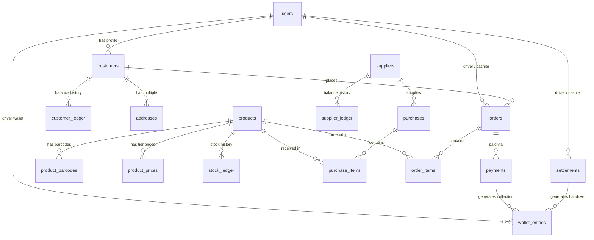

# Implementation Plan: Wholesale Shop Management System Architecture & Database Schema

## Goal Description
Build an end-to-end Wholesale Shop Management System with an append-only ledger architecture for stock, customer debt, supplier debt, and driver cash collections. The solution consists of:
1. **A unified backend (PostgreSQL / Supabase)**: Encapsulating all transactional business logic (`post_purchase`, `post_sale`, `confirm_order`, `deliver_order`, `settle_wallet`), Row-Level Security (RLS), and audit triggers.
2. **A shared Flutter monorepo**: Containing two client applications (`staff_app` and `customer_app`) and shared core packages for domain models, API clients, local persistence (Drift), hardware integrations (ESC/POS printing & barcode scanning), and Arabic/French localization (RTL/LTR).

---

## User Review Required

> [!IMPORTANT]
> **Financial & Currency Representation**: All monetary figures (`prices`, `balances`, `wallet totals`) are modeled in **centimes (BIGINT)** in PostgreSQL to eliminate IEEE-754 floating-point inaccuracies. $1\text{ DZD} = 100\text{ centimes}$. A shop setting toggle will control whether the UI displays whole Dinars or Dinars with two decimal centimes.

> [!IMPORTANT]
> **Zero-Editable State Principle**: On-hand stock, customer balance, supplier balance, and driver wallet balance are **never** stored as standalone mutable integer fields. They are strictly derived from append-only ledger entries (`stock_ledger`, `customer_ledger`, `supplier_ledger`, `wallet_entries`). For performance, materialized views or cached summary tables updated exclusively by DB triggers are used for fast queries.

> [!WARNING]
> **Offline Driver Sync Idempotency**: Drivers may collect cash in connectivity dead zones. Every collection and delivery is assigned a client-generated UUID (`client_id`). The backend guarantees idempotent upserts/inserts so network retry bursts cannot double-count money or duplicate status updates.

---

## Open Questions & Business Decision Options

> [!CAUTION]
> Please review and confirm the following project decisions before writing code:
1. **Exact Stock Display for Customers**: Should customers see the exact integer quantity available (e.g., *"142 cartons in stock"*), or a simple status badge (*"In Stock"* / *"Low Stock"* / *"Out of Stock"*) to protect wholesale trade confidentiality?
2. **Customer Registration & Credit Approval**: Can any self-registered customer buy on credit, or must the cashier/moderator explicitly approve customer accounts and configure an individual `credit_limit`? *(Defaulting to: credit limit = 0 DZD until approved).*
3. **Delivery Fee Calculation**: Is delivery free for wholesale orders, a flat fee per order, or calculated per distance/municipality zone?
4. **Thermal Printer & Barcode Hardware**: Does the shop use standard ESC/POS 58mm/80mm Bluetooth printers, or network LAN/Wi-Fi thermal printers at the counter?

---

## Proposed Changes

```
c:\Users\fethi\Desktop\vipSmock\
├── backend/
│   └── supabase/
│       ├── migrations/
│       │   ├── 00001_initial_schema.sql
│       │   ├── 00002_ledgers_and_indexes.sql
│       │   ├── 00003_audit_triggers.sql
│       │   ├── 00004_transaction_rpc_functions.sql
│       │   └── 00005_row_level_security.sql
│       └── seed.sql
└── apps/
    ├── staff_app/                  # Single Flutter app for Moderator, Manager, Cashier, Driver
    │   ├── lib/
    │   ├── pubspec.yaml
    │   └── test/
    ├── customer_app/               # Flutter app for wholesale buyers
    │   ├── lib/
    │   ├── pubspec.yaml
    │   └── test/
    └── packages/                   # Shared Monorepo Packages (Melos workspace)
        ├── core/                   # Utilities, formatting, currency (DZD), errors
        ├── domain/                 # Entity definitions, value objects, business rules
        ├── data/                   # Supabase client, Drift DB, Repositories
        ├── ui_kit/                 # Shared widgets, RTL/LTR styling, design system
        └── l10n/                   # ARB files (app_ar.arb, app_fr.arb), generated delegates
```

---

### Component 1: Complete PostgreSQL Database Schema & Ledgers

The database enforces all constraints, transactions, append-only ledgers, and audit trails.

#### Entity Relationship Diagram



#### SQL Schema DDL (Supabase / Postgres 15+)

```sql
-- ============================================================
-- 1. ENUMS & EXTENSIONS
-- ============================================================
CREATE EXTENSION IF NOT EXISTS "uuid-ossp";
CREATE EXTENSION IF NOT EXISTS "pgcrypto";

CREATE TYPE user_role AS ENUM (
  'moderator', 
  'manager', 
  'cashier', 
  'driver', 
  'customer'
);

CREATE TYPE price_tier AS ENUM (
  'retail', 
  'wholesale', 
  'bulk'
);

CREATE TYPE purchase_status AS ENUM (
  'draft', 
  'posted', 
  'cancelled'
);

CREATE TYPE order_channel AS ENUM (
  'store', 
  'online'
);

CREATE TYPE order_status AS ENUM (
  'submitted',        -- Online order placed by customer
  'confirmed',        -- Cashier confirmed (reserves stock)
  'assigned',         -- Assigned to delivery driver
  'accepted',         -- Driver accepted
  'refused',          -- Driver refused (returns to queue)
  'out_for_delivery', -- Driver departed
  'delivered',        -- Delivered & cash recorded
  'settled',          -- Cash closed at end-of-day
  'cancelled'         -- Cancelled / returned
);

CREATE TYPE payment_method AS ENUM (
  'cash', 
  'customer_balance', 
  'mixed'
);

CREATE TYPE payment_status AS ENUM (
  'collected', 
  'settled', 
  'reversed'
);

CREATE TYPE wallet_entry_type AS ENUM (
  'collection', 
  'handover', 
  'shortage', 
  'overage', 
  'reversal'
);

CREATE TYPE settlement_status AS ENUM (
  'pending', 
  'settled', 
  'discrepancy_flagged', 
  'approved'
);

CREATE TYPE stock_ref_type AS ENUM (
  'purchase', 
  'sale', 
  'return', 
  'adjustment'
);

-- ============================================================
-- 2. USERS & PROFILES
-- ============================================================
CREATE TABLE users (
    id UUID PRIMARY KEY REFERENCES auth.users(id) ON DELETE RESTRICT,
    phone VARCHAR(20) NOT NULL UNIQUE,
    name VARCHAR(100) NOT NULL,
    role user_role NOT NULL DEFAULT 'customer',
    active BOOLEAN NOT NULL DEFAULT TRUE,
    language VARCHAR(5) NOT NULL DEFAULT 'ar' CHECK (language IN ('ar', 'fr')),
    created_at TIMESTAMPTZ NOT NULL DEFAULT NOW(),
    updated_at TIMESTAMPTZ NOT NULL DEFAULT NOW()
);

CREATE TABLE customers (
    id UUID PRIMARY KEY DEFAULT gen_random_uuid(),
    user_id UUID NOT NULL UNIQUE REFERENCES users(id) ON DELETE CASCADE,
    price_tier price_tier NOT NULL DEFAULT 'wholesale',
    credit_limit BIGINT NOT NULL DEFAULT 0, -- In centimes (0 = strictly cash)
    created_at TIMESTAMPTZ NOT NULL DEFAULT NOW(),
    updated_at TIMESTAMPTZ NOT NULL DEFAULT NOW()
);

CREATE TABLE addresses (
    id UUID PRIMARY KEY DEFAULT gen_random_uuid(),
    customer_id UUID NOT NULL REFERENCES customers(id) ON DELETE CASCADE,
    label VARCHAR(50) NOT NULL, -- e.g. 'Main Store', 'Warehouse 2'
    address_text TEXT NOT NULL,
    wilaya VARCHAR(50) NOT NULL,
    commune VARCHAR(50) NOT NULL,
    latitude DOUBLE PRECISION,
    longitude DOUBLE PRECISION,
    is_default BOOLEAN NOT NULL DEFAULT FALSE,
    created_at TIMESTAMPTZ NOT NULL DEFAULT NOW()
);

CREATE TABLE suppliers (
    id UUID PRIMARY KEY DEFAULT gen_random_uuid(),
    name VARCHAR(150) NOT NULL,
    phone VARCHAR(20) NOT NULL,
    company_register VARCHAR(50),
    notes TEXT,
    created_at TIMESTAMPTZ NOT NULL DEFAULT NOW()
);

-- ============================================================
-- 3. PRODUCTS, BARCODES & PRICING TIERS
-- ============================================================
CREATE TABLE products (
    id UUID PRIMARY KEY DEFAULT gen_random_uuid(),
    name_ar VARCHAR(200) NOT NULL,
    name_fr VARCHAR(200) NOT NULL,
    category VARCHAR(100) NOT NULL,
    unit VARCHAR(20) NOT NULL DEFAULT 'piece', -- 'piece', 'box', 'carton', 'kg'
    pack_size INT NOT NULL DEFAULT 1,          -- units per carton
    photo_url TEXT,
    last_unit_cost BIGINT NOT NULL DEFAULT 0,  -- In centimes
    min_stock_alert INT NOT NULL DEFAULT 5,
    active BOOLEAN NOT NULL DEFAULT TRUE,
    created_at TIMESTAMPTZ NOT NULL DEFAULT NOW(),
    updated_at TIMESTAMPTZ NOT NULL DEFAULT NOW()
);

CREATE TABLE product_barcodes (
    barcode VARCHAR(64) PRIMARY KEY,
    product_id UUID NOT NULL REFERENCES products(id) ON DELETE CASCADE,
    units_per_scan INT NOT NULL DEFAULT 1,      -- 1 for unit barcode, 12 or 24 for box
    created_at TIMESTAMPTZ NOT NULL DEFAULT NOW()
);

CREATE TABLE product_prices (
    id UUID PRIMARY KEY DEFAULT gen_random_uuid(),
    product_id UUID NOT NULL REFERENCES products(id) ON DELETE CASCADE,
    tier price_tier NOT NULL,
    min_qty INT NOT NULL DEFAULT 1,
    price BIGINT NOT NULL CHECK (price >= 0),   -- In centimes
    created_at TIMESTAMPTZ NOT NULL DEFAULT NOW(),
    CONSTRAINT uq_product_tier_min_qty UNIQUE(product_id, tier, min_qty)
);

-- ============================================================
-- 4. PURCHASES (SUPPLIERS)
-- ============================================================
CREATE TABLE purchases (
    id UUID PRIMARY KEY DEFAULT gen_random_uuid(),
    supplier_id UUID NOT NULL REFERENCES suppliers(id),
    invoice_no VARCHAR(100) NOT NULL,
    invoice_date DATE NOT NULL DEFAULT CURRENT_DATE,
    status purchase_status NOT NULL DEFAULT 'draft',
    total_amount BIGINT NOT NULL DEFAULT 0,    -- In centimes
    created_by UUID NOT NULL REFERENCES users(id),
    posted_at TIMESTAMPTZ,
    created_at TIMESTAMPTZ NOT NULL DEFAULT NOW(),
    CONSTRAINT uq_supplier_invoice UNIQUE(supplier_id, invoice_no)
);

CREATE TABLE purchase_items (
    id UUID PRIMARY KEY DEFAULT gen_random_uuid(),
    purchase_id UUID NOT NULL REFERENCES purchases(id) ON DELETE CASCADE,
    product_id UUID NOT NULL REFERENCES products(id),
    quantity INT NOT NULL CHECK (quantity > 0),
    unit_cost BIGINT NOT NULL CHECK (unit_cost >= 0),
    selling_price BIGINT NOT NULL CHECK (selling_price >= unit_cost),
    created_at TIMESTAMPTZ NOT NULL DEFAULT NOW()
);

-- ============================================================
-- 5. ORDERS & SALES
-- ============================================================
CREATE TABLE orders (
    id UUID PRIMARY KEY DEFAULT gen_random_uuid(),
    order_number BIGSERIAL UNIQUE,
    channel order_channel NOT NULL,
    customer_id UUID REFERENCES customers(id), -- NULL for anonymous counter sale
    status order_status NOT NULL DEFAULT 'submitted',
    driver_id UUID REFERENCES users(id),       -- For delivery
    cashier_id UUID REFERENCES users(id),      -- Creator or processor
    delivery_address JSONB,                    -- Snapshot of address at order time
    total_amount BIGINT NOT NULL DEFAULT 0,    -- In centimes
    total_cost BIGINT NOT NULL DEFAULT 0,      -- Snapshot of costs for gross margin
    paid_amount BIGINT NOT NULL DEFAULT 0,     -- In centimes
    notes TEXT,
    created_at TIMESTAMPTZ NOT NULL DEFAULT NOW(),
    confirmed_at TIMESTAMPTZ,
    delivered_at TIMESTAMPTZ,
    settled_at TIMESTAMPTZ
);

CREATE TABLE order_items (
    id UUID PRIMARY KEY DEFAULT gen_random_uuid(),
    order_id UUID NOT NULL REFERENCES orders(id) ON DELETE CASCADE,
    product_id UUID NOT NULL REFERENCES products(id),
    quantity INT NOT NULL CHECK (quantity > 0),
    unit_price BIGINT NOT NULL CHECK (unit_price >= 0),
    unit_cost BIGINT NOT NULL DEFAULT 0,       -- Snapshot for margin tracking
    created_at TIMESTAMPTZ NOT NULL DEFAULT NOW()
);

-- ============================================================
-- 6. APPEND-ONLY LEDGERS (THE SOURCE OF TRUTH)
-- ============================================================

-- A. STOCK LEDGER
CREATE TABLE stock_ledger (
    id UUID PRIMARY KEY DEFAULT gen_random_uuid(),
    product_id UUID NOT NULL REFERENCES products(id),
    qty_change INT NOT NULL,                  -- Positive (in) or Negative (out)
    reason stock_ref_type NOT NULL,
    ref_type VARCHAR(50) NOT NULL,            -- 'purchase', 'order', 'adjustment'
    ref_id UUID NOT NULL,
    user_id UUID NOT NULL REFERENCES users(id),
    notes TEXT,
    created_at TIMESTAMPTZ NOT NULL DEFAULT NOW()
);

-- B. CUSTOMER DEBT LEDGER
CREATE TABLE customer_ledger (
    id UUID PRIMARY KEY DEFAULT gen_random_uuid(),
    customer_id UUID NOT NULL REFERENCES customers(id),
    amount_change BIGINT NOT NULL,            -- Positive (customer debt increases), Negative (decreases)
    ref_type VARCHAR(50) NOT NULL,            -- 'order_credit', 'payment', 'return_refund'
    ref_id UUID NOT NULL,
    notes TEXT,
    created_at TIMESTAMPTZ NOT NULL DEFAULT NOW()
);

-- C. SUPPLIER DEBT LEDGER
CREATE TABLE supplier_ledger (
    id UUID PRIMARY KEY DEFAULT gen_random_uuid(),
    supplier_id UUID NOT NULL REFERENCES suppliers(id),
    amount_change BIGINT NOT NULL,            -- Positive (shop owes supplier), Negative (payment made)
    ref_type VARCHAR(50) NOT NULL,            -- 'purchase', 'supplier_payment'
    ref_id UUID NOT NULL,
    notes TEXT,
    created_at TIMESTAMPTZ NOT NULL DEFAULT NOW()
);

-- ============================================================
-- 7. PAYMENTS, WALLETS & END-OF-DAY SETTLEMENT
-- ============================================================
CREATE TABLE payments (
    id UUID PRIMARY KEY DEFAULT gen_random_uuid(),
    order_id UUID REFERENCES orders(id),
    customer_id UUID REFERENCES customers(id),
    amount BIGINT NOT NULL CHECK (amount > 0),
    method payment_method NOT NULL DEFAULT 'cash',
    received_by UUID NOT NULL REFERENCES users(id),
    status payment_status NOT NULL DEFAULT 'collected',
    client_id UUID UNIQUE,                    -- Offline idempotency key
    created_at TIMESTAMPTZ NOT NULL DEFAULT NOW()
);

CREATE TABLE settlements (
    id UUID PRIMARY KEY DEFAULT gen_random_uuid(),
    driver_id UUID NOT NULL REFERENCES users(id),
    cashier_id UUID NOT NULL REFERENCES users(id),
    expected_amount BIGINT NOT NULL,          -- In centimes
    counted_amount BIGINT NOT NULL,           -- In centimes
    difference BIGINT GENERATED ALWAYS AS (counted_amount - expected_amount) STORED,
    status settlement_status NOT NULL DEFAULT 'settled',
    approved_by UUID REFERENCES users(id),
    notes TEXT,
    created_at TIMESTAMPTZ NOT NULL DEFAULT NOW()
);

CREATE TABLE wallet_entries (
    id UUID PRIMARY KEY DEFAULT gen_random_uuid(),
    driver_id UUID NOT NULL REFERENCES users(id),
    type wallet_entry_type NOT NULL,
    amount BIGINT NOT NULL CHECK (amount > 0), -- Magnitude
    payment_id UUID REFERENCES payments(id),
    settlement_id UUID REFERENCES settlements(id),
    client_id UUID UNIQUE,                     -- Offline idempotency key
    created_at TIMESTAMPTZ NOT NULL DEFAULT NOW()
);

-- ============================================================
-- 8. AUDIT LOG (SYSTEM INTEGRITY)
-- ============================================================
CREATE TABLE audit_log (
    id BIGSERIAL PRIMARY KEY,
    user_id UUID REFERENCES users(id),
    action VARCHAR(50) NOT NULL,
    target_table VARCHAR(50) NOT NULL,
    target_id UUID,
    before_state JSONB,
    after_state JSONB,
    ip_address INET,
    created_at TIMESTAMPTZ NOT NULL DEFAULT NOW()
);
```

#### Database Helper Views for Live Ledger Balances

```sql
-- Fast view for current stock and customer available stock
CREATE OR REPLACE VIEW view_product_stock AS
SELECT 
    p.id AS product_id,
    p.name_ar,
    p.name_fr,
    p.active,
    COALESCE(SUM(sl.qty_change), 0) AS on_hand_qty,
    COALESCE(res.reserved_qty, 0) AS reserved_qty,
    (COALESCE(SUM(sl.qty_change), 0) - COALESCE(res.reserved_qty, 0)) AS available_qty
FROM products p
LEFT JOIN stock_ledger sl ON p.id = sl.product_id
LEFT JOIN (
    SELECT oi.product_id, SUM(oi.quantity) AS reserved_qty
    FROM order_items oi
    JOIN orders o ON oi.order_id = o.id
    WHERE o.status IN ('confirmed', 'assigned', 'accepted', 'out_for_delivery')
    GROUP BY oi.product_id
) res ON p.id = res.product_id
GROUP BY p.id, res.reserved_qty;

-- Driver Wallet Balance
CREATE OR REPLACE VIEW view_driver_wallet_balance AS
SELECT 
    driver_id,
    COALESCE(SUM(
        CASE 
            WHEN type = 'collection' THEN amount
            WHEN type = 'handover' THEN -amount
            ELSE 0
        END
    ), 0) AS current_wallet_balance
FROM wallet_entries
GROUP BY driver_id;

-- Customer Running Debt Balance
CREATE OR REPLACE VIEW view_customer_balance AS
SELECT 
    c.id AS customer_id,
    c.user_id,
    c.credit_limit,
    COALESCE(SUM(cl.amount_change), 0) AS current_balance -- positive means customer owes shop
FROM customers c
LEFT JOIN customer_ledger cl ON c.id = cl.customer_id
GROUP BY c.id;
```

#### Atomic Postgres RPC Functions (Single-Transaction Ledger Operations)

```sql
-- 1. POST PURCHASE (Stock + Supplier Ledger)
CREATE OR REPLACE FUNCTION rpc_post_purchase(p_purchase_id UUID, p_user_id UUID)
RETURNS JSONB
LANGUAGE plpgsql
SECURITY DEFINER
AS $$
DECLARE
    v_purchase purchases%ROWTYPE;
    v_item RECORD;
    v_total_amount BIGINT := 0;
BEGIN
    SELECT * INTO v_purchase FROM purchases WHERE id = p_purchase_id FOR UPDATE;
    IF NOT FOUND THEN RAISE EXCEPTION 'Purchase % not found', p_purchase_id; END IF;
    IF v_purchase.status <> 'draft' THEN RAISE EXCEPTION 'Purchase is already posted or cancelled'; END IF;

    -- Calculate total and update stock
    FOR v_item IN (SELECT * FROM purchase_items WHERE purchase_id = p_purchase_id) LOOP
        v_total_amount := v_total_amount + (v_item.quantity * v_item.unit_cost);

        -- Write stock ledger
        INSERT INTO stock_ledger (product_id, qty_change, reason, ref_type, ref_id, user_id)
        VALUES (v_item.product_id, v_item.quantity, 'purchase', 'purchase', p_purchase_id, p_user_id);

        -- Update product last cost & activate
        UPDATE products 
        SET last_unit_cost = v_item.unit_cost,
            active = TRUE,
            updated_at = NOW()
        WHERE id = v_item.product_id;
    END LOOP;

    -- Update supplier ledger (credit supplier)
    INSERT INTO supplier_ledger (supplier_id, amount_change, ref_type, ref_id)
    VALUES (v_purchase.supplier_id, v_total_amount, 'purchase', p_purchase_id);

    -- Mark purchase as posted
    UPDATE purchases 
    SET status = 'posted', 
        total_amount = v_total_amount, 
        posted_at = NOW() 
    WHERE id = p_purchase_id;

    RETURN jsonb_build_object('status', 'success', 'total_amount', v_total_amount);
END;
$$;

-- 2. POST IN-STORE SALE (Counter sale: Stock + Cash / Customer Ledger)
CREATE OR REPLACE FUNCTION rpc_post_store_sale(
    p_cashier_id UUID,
    p_customer_id UUID,          -- Optional
    p_items JSONB,               -- [{product_id, quantity, unit_price, unit_cost}]
    p_paid_cash BIGINT,          -- In centimes
    p_on_account BIGINT          -- In centimes
)
RETURNS JSONB
LANGUAGE plpgsql
SECURITY DEFINER
AS $$
DECLARE
    v_order_id UUID := gen_random_uuid();
    v_item JSONB;
    v_total_amount BIGINT := 0;
    v_total_cost BIGINT := 0;
    v_current_stock INT;
    v_product_id UUID;
    v_qty INT;
    v_price BIGINT;
    v_cost BIGINT;
BEGIN
    -- 1. Create order header
    INSERT INTO orders (id, channel, customer_id, status, cashier_id, total_amount, paid_amount)
    VALUES (v_order_id, 'store', p_customer_id, 'delivered', p_cashier_id, 0, p_paid_cash);

    -- 2. Process items
    FOR v_item IN SELECT * FROM jsonb_array_elements(p_items) LOOP
        v_product_id := (v_item->>'product_id')::UUID;
        v_qty := (v_item->>'quantity')::INT;
        v_price := (v_item->>'unit_price')::BIGINT;
        v_cost := (v_item->>'unit_cost')::BIGINT;

        -- Stock check
        SELECT available_qty INTO v_current_stock FROM view_product_stock WHERE product_id = v_product_id;
        IF v_current_stock < v_qty THEN
            RAISE EXCEPTION 'Insufficient stock for product %: requested %, available %', v_product_id, v_qty, v_current_stock;
        END IF;

        v_total_amount := v_total_amount + (v_qty * v_price);
        v_total_cost := v_total_cost + (v_qty * v_cost);

        -- Insert order item
        INSERT INTO order_items (order_id, product_id, quantity, unit_price, unit_cost)
        VALUES (v_order_id, v_product_id, v_qty, v_price, v_cost);

        -- Deduct from stock ledger
        INSERT INTO stock_ledger (product_id, qty_change, reason, ref_type, ref_id, user_id)
        VALUES (v_product_id, -v_qty, 'sale', 'order', v_order_id, p_cashier_id);
    END LOOP;

    -- Update order totals
    UPDATE orders 
    SET total_amount = v_total_amount, 
        total_cost = v_total_cost, 
        delivered_at = NOW()
    WHERE id = v_order_id;

    -- 3. Handle debt on customer balance if any
    IF p_on_account > 0 THEN
        IF p_customer_id IS NULL THEN
            RAISE EXCEPTION 'Cannot put amount on balance without a registered customer.';
        END IF;
        INSERT INTO customer_ledger (customer_id, amount_change, ref_type, ref_id, notes)
        VALUES (p_customer_id, p_on_account, 'order_credit', v_order_id, 'In-store sale credit');
    END IF;

    -- 4. Record payment entry for cash in till
    IF p_paid_cash > 0 THEN
        INSERT INTO payments (order_id, customer_id, amount, method, received_by, status)
        VALUES (v_order_id, p_customer_id, p_paid_cash, 'cash', p_cashier_id, 'settled');
    END IF;

    RETURN jsonb_build_object('order_id', v_order_id, 'total', v_total_amount, 'status', 'success');
END;
$$;

-- 3. RECORD DELIVERY & CASH COLLECTION (Driver action, idempotent via client_id)
CREATE OR REPLACE FUNCTION rpc_record_order_delivery(
    p_driver_id UUID,
    p_order_id UUID,
    p_collected_cash BIGINT,
    p_client_id UUID
)
RETURNS JSONB
LANGUAGE plpgsql
SECURITY DEFINER
AS $$
DECLARE
    v_order orders%ROWTYPE;
    v_unpaid_amount BIGINT;
    v_payment_id UUID;
BEGIN
    SELECT * INTO v_order FROM orders WHERE id = p_order_id FOR UPDATE;
    IF NOT FOUND THEN RAISE EXCEPTION 'Order % not found', p_order_id; END IF;
    IF v_order.status = 'delivered' OR v_order.status = 'settled' THEN
        RETURN jsonb_build_object('status', 'already_delivered', 'order_id', p_order_id);
    END IF;

    -- Calculate unpaid part
    v_unpaid_amount := v_order.total_amount - p_collected_cash;

    -- If cash was received, record payment and add to driver wallet
    IF p_collected_cash > 0 THEN
        INSERT INTO payments (id, order_id, customer_id, amount, method, received_by, status, client_id)
        VALUES (gen_random_uuid(), p_order_id, v_order.customer_id, p_collected_cash, 'cash', p_driver_id, 'collected', p_client_id)
        ON CONFLICT (client_id) DO UPDATE SET amount = EXCLUDED.amount
        RETURNING id INTO v_payment_id;

        INSERT INTO wallet_entries (driver_id, type, amount, payment_id, client_id)
        VALUES (p_driver_id, 'collection', p_collected_cash, v_payment_id, p_client_id)
        ON CONFLICT (client_id) DO NOTHING;
    END IF;

    -- If unpaid, transfer remainder to customer ledger debt
    IF v_unpaid_amount > 0 AND v_order.customer_id IS NOT NULL THEN
        INSERT INTO customer_ledger (customer_id, amount_change, ref_type, ref_id, notes)
        VALUES (v_order.customer_id, v_unpaid_amount, 'order_credit', p_order_id, 'Delivery remaining unpaid balance');
    END IF;

    -- Deduct actual inventory from stock ledger now that order is delivered
    INSERT INTO stock_ledger (product_id, qty_change, reason, ref_type, ref_id, user_id)
    SELECT oi.product_id, -oi.quantity, 'sale', 'order', p_order_id, p_driver_id
    FROM order_items oi
    WHERE oi.order_id = p_order_id;

    -- Update order status
    UPDATE orders 
    SET status = 'delivered', 
        paid_amount = p_collected_cash, 
        delivered_at = NOW()
    WHERE id = p_order_id;

    RETURN jsonb_build_object('status', 'success', 'order_id', p_order_id);
END;
$$;

-- 4. END-OF-DAY WALLET SETTLEMENT (Cashier counts driver cash)
CREATE OR REPLACE FUNCTION rpc_settle_driver_wallet(
    p_cashier_id UUID,
    p_driver_id UUID,
    p_counted_cash BIGINT,
    p_notes TEXT
)
RETURNS JSONB
LANGUAGE plpgsql
SECURITY DEFINER
AS $$
DECLARE
    v_expected_cash BIGINT := 0;
    v_difference BIGINT := 0;
    v_settlement_id UUID := gen_random_uuid();
    v_status settlement_status := 'settled';
BEGIN
    -- 1. Lock driver's pending wallet entries
    SELECT COALESCE(SUM(
        CASE 
            WHEN type = 'collection' THEN amount
            WHEN type = 'handover' THEN -amount
            ELSE 0
        END
    ), 0) INTO v_expected_cash
    FROM wallet_entries
    WHERE driver_id = p_driver_id;

    IF v_expected_cash <= 0 AND p_counted_cash = 0 THEN
        RAISE EXCEPTION 'No pending collections found to settle for driver %', p_driver_id;
    END IF;

    v_difference := p_counted_cash - v_expected_cash;
    IF v_difference <> 0 THEN
        v_status := 'discrepancy_flagged';
    END IF;

    -- 2. Create settlement record
    INSERT INTO settlements (id, driver_id, cashier_id, expected_amount, counted_amount, status, notes)
    VALUES (v_settlement_id, p_driver_id, p_cashier_id, v_expected_cash, p_counted_cash, v_status, p_notes);

    -- 3. Write handover entry into driver wallet to decrease balance by expected amount
    INSERT INTO wallet_entries (driver_id, type, amount, settlement_id)
    VALUES (p_driver_id, 'handover', v_expected_cash, v_settlement_id);

    -- 4. Mark all delivered orders for this driver as 'settled'
    UPDATE orders 
    SET status = 'settled', 
        settled_at = NOW()
    WHERE driver_id = p_driver_id AND status = 'delivered';

    -- 5. Mark payments as settled
    UPDATE payments
    SET status = 'settled'
    WHERE received_by = p_driver_id AND status = 'collected';

    RETURN jsonb_build_object(
        'settlement_id', v_settlement_id,
        'expected', v_expected_cash,
        'counted', p_counted_cash,
        'difference', v_difference,
        'status', v_status
    );
END;
$$;
```

---

### Component 2: Frontend Monorepo & Flutter App Structure

The codebase is organized as a multi-package Flutter monorepo managed with **Melos**.

```
c:\Users\fethi\Desktop\vipSmock\
├── melos.yaml
├── pubspec.yaml
├── packages/
│   ├── core/                       # Core foundation
│   │   ├── lib/
│   │   │   ├── constants/          # DZD currency helpers, AppConstants
│   │   │   ├── error/              # Failure & Exception classes
│   │   │   └── utils/              # Barcode sanitizers, date formatters
│   │   └── pubspec.yaml
│   ├── domain/                     # Pure Dart Domain Layer
│   │   ├── lib/
│   │   │   ├── entities/           # Product, Order, Purchase, LedgerEntry, WalletEntry
│   │   │   ├── repositories/       # Abstract repository interfaces
│   │   │   └── value_objects/      # CentimesMoney, PriceTier, UserRole
│   │   └── pubspec.yaml
│   ├── data/                       # Infrastructure & Persistence
│   │   ├── lib/
│   │   │   ├── datasources/
│   │   │   │   ├── remote/         # SupabaseClient, SupabaseRpc
│   │   │   │   └── local/          # Drift Database (SQLite) for offline sync & caching
│   │   │   ├── repositories/       # Implementations of Domain Repositories
│   │   │   └── sync/               # Offline queue manager & auto-sync worker
│   │   └── pubspec.yaml
│   ├── ui_kit/                     # Shared UI Components & Themes
│   │   ├── lib/
│   │   │   ├── theme/              # Emerald & Slate palette, Material 3, Typography
│   │   │   ├── widgets/            # NumericKeypad, BarcodeScannerModal, ReceiptPreview
│   │   │   └── layout/             # ResponsiveScaffold, DirectionalPadding (RTL/LTR safe)
│   │   └── pubspec.yaml
│   └── l10n/                       # Localization
│       ├── l10n.yaml
│       ├── lib/l10n/
│       │   ├── app_ar.arb          # Arabic translations (RTL)
│       │   └── app_fr.arb          # French translations (LTR)
│       └── pubspec.yaml
└── apps/
    ├── staff_app/                  # Internal staff app (Moderator, Manager, Cashier, Driver)
    │   ├── lib/
    │   │   ├── app.dart
    │   │   ├── router/             # GoRouter with Role-based Guards
    │   │   ├── features/
    │   │   │   ├── auth/           # Staff login screen (phone + password)
    │   │   │   ├── moderator/      # Analytics dashboard, user management, discrepancy approval
    │   │   │   ├── manager/        # Purchase receiving, barcode lookup, price tiers, stock adjustments
    │   │   │   ├── cashier/        # POS counter sale, order dispatch, driver cash settlement
    │   │   │   ├── driver/         # Order list, acceptance, delivery recording, wallet sync
    │   │   │   └── hardware/       # ESC/POS Bluetooth thermal printing, MobileScanner & USB wedge
    │   │   └── main.dart
    │   └── pubspec.yaml
    └── customer_app/               # Wholesale Customer App (Android / iOS / Web)
        ├── lib/
        │   ├── app.dart
        │   ├── router/             # GoRouter (Customer catalog, cart, orders, profile)
        │   ├── features/
        │   │   ├── auth/           # Self-registration with phone & address
        │   │   ├── catalog/        # Live stock browsing, search, category filters
        │   │   ├── cart/           # Tier-priced cart, pack size multipliers
        │   │   ├── orders/         # Real-time order tracking (Supabase Realtime)
        │   │   └── balance/        # Account debt statement & history
        │   └── main.dart
        └── pubspec.yaml
```

---

### Component 3: Offline Synchronization & Hardware Integration

#### 1. Drift Local SQLite Schema for Driver Offline Mode
The driver app maintains an offline queue table in Drift:

```dart
// Drift table definition
class OfflineSyncQueue extends Table {
  TextColumn get clientId => text()(); // UUID generated on device
  TextColumn get entityType => text()(); // 'delivery_record', 'wallet_collection'
  TextColumn get payloadJson => text()(); // Serialized arguments
  DateTimeColumn get createdAt => dateTime()();
  BoolColumn get isSynced => boolean().withDefault(const Constant(false))();
  IntColumn get retryCount => integer().withDefault(const Constant(0))();

  @override
  Set<Column> get primaryKey => {clientId};
}
```

When network restores:
1. `SyncCoordinator` scans `OfflineSyncQueue.where((tbl) => tbl.isSynced.equals(false))`.
2. Sends records to `rpc_record_order_delivery` using the `clientId`.
3. Due to PostgreSQL `ON CONFLICT (client_id) DO NOTHING`, duplicate network transmissions will never double-record money or stock deductions.

#### 2. Thermal Printing Architecture (ESC/POS)
The `staff_app` implements receipt generation via `printing` and `esc_pos_utils_plus`:
- **Counter In-Store Receipt**: Formatted with shop header, order number, Arabic/French line items, total in DZD, cashier name, and barcode/QR code.
- **Driver Delivery Slip**: Formatted with customer contact, delivery address, items delivered, cash collected, and customer balance forward.
- **Arabic Text Shaping**: Uses a pre-rasterized bitmap canvas rendering approach for Arabic text on thermal printers that lack native Arabic codepage fonts.

---

## Verification Plan

### Automated Tests
1. **PostgreSQL RPC Unit Tests (pgTAP or Supabase Test Runner)**:
   - Verify `rpc_post_purchase` adds exact `qty_change` to `stock_ledger` and increases `supplier_ledger`.
   - Verify `rpc_post_store_sale` aborts with exception when stock is insufficient.
   - Verify `rpc_record_order_delivery` assigns collection to driver's wallet and updates `customer_ledger` if unpaid.
   - Verify `rpc_settle_driver_wallet` resets wallet balance to zero and creates a `discrepancy_flagged` settlement if `counted != expected`.
2. **Flutter Unit & Widget Tests**:
   - Money & Centimes conversion tests (`DzdFormatter.formatCentimes(125050)` -> `"1 250,50 DZD"`).
   - GoRouter redirection tests verifying drivers cannot access manager or moderator routes.
   - Offline queue idempotent replay test using mock HTTP responses.

### Manual Verification
1. **Purchase Flow**:
   - Manager logs in, scans an unknown barcode -> fills Arabic & French names -> sets wholesale tier prices -> posts purchase.
   - Inspect `stock_ledger` and `supplier_ledger` to confirm entries match invoice.
2. **Online Order -> Dispatch -> Delivery Flow**:
   - Customer places an order on `customer_app`.
   - Cashier confirms order on `staff_app` (reserves stock) and assigns driver.
   - Driver accepts order on phone, marks delivered with partial cash.
   - Cashier executes end-of-day settlement and counts cash.
   - Moderator checks dashboard: revenue, margins, driver wallets, and ledger reconciliation.
